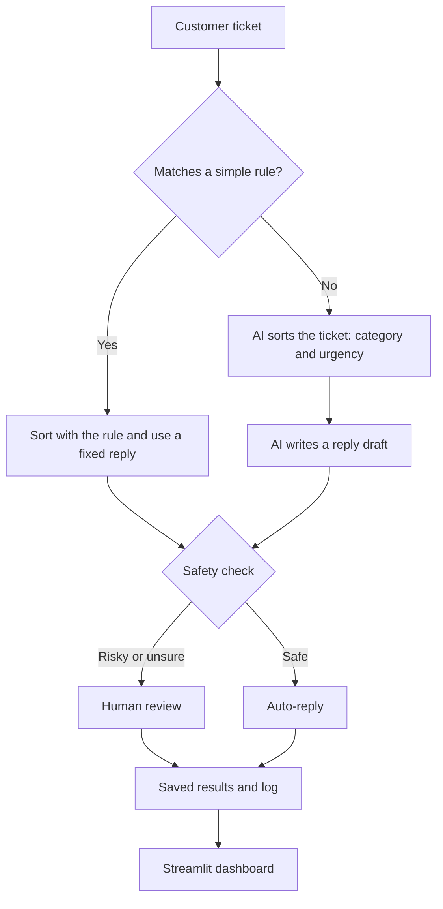

# AI Support Ticket Helper

An AI system that sorts customer support tickets, drafts replies, and sends risky tickets to a human. It runs fully on a laptop with a free local model, so it costs nothing to run.


## Why I built it

Support teams spend a lot of time reading and sorting the same kinds of messages. I wanted to build a small version of a real AI system where the model is only one part of the design, and where plain code decides what is safe to send.

## What it does

1. **Rules first.** Easy tickets (unsubscribe, opening hours, password reset, returns) are handled by plain code. No AI is used, and they get a fixed reply.
2. **AI sorts the rest.** A local language model picks a category and an urgency. Pydantic forces the answer into a fixed shape.
3. **A reply is drafted.** The model writes a short reply in a style that matches the category.
4. **A safety check decides.** Risky tickets go to a human instead of being sent automatically.
5. **Everything is logged and saved.** A Streamlit dashboard shows the results, and has a live box to try a new ticket.

## Workflow



## Safety check

A ticket is sent to a human if any of these is true. This check is plain code, not AI, so it behaves the same every time.

| Check | Why |
|---|---|
| Urgency is high | The customer is blocked or losing money right now. |
| Category is billing or refund | Money decisions need a person. |
| The reply contains a number or time | The model can invent facts, such as made-up opening hours. |
| The reply contains a risky word (for example "guarantee" or "promise") | The model should never promise things on behalf of the company. |

## Tech stack

| Part | Tool |
|---|---|
| Language | Python 3.12 |
| Model | llama3.2, run locally with Ollama |
| Model access | OpenAI-compatible Python SDK (the model and server are set in `.env`) |
| Structured output | Pydantic |
| Dashboard | Streamlit |
| Tests | pytest |
| Packages and environment | uv |
| Version control | Git and GitHub |

## Results

Measured against a hand-labeled answer key of 30 fake tickets.

| Test | Category | Urgency |
|---|---|---|
| First version (tickets 1-10) | 9 of 10 | 7 of 10 |
| After prompt and rule changes (tickets 1-10) | 10 of 10 | 10 of 10 |
| Fresh tickets never used for tuning (tickets 11-30) | 19 of 20 | 18 of 20 |

All 3 mistakes on the fresh tickets were still sent to a human by the safety check, so no wrong automatic reply was sent.

## Project structure

```
ticket_helper/
├── src/
│   ├── classifier.py   AI sorter: category and urgency
│   ├── rules.py        simple rules that run before the AI
│   ├── replier.py      reply writer, one style per category, plus fixed replies
│   └── safety.py       decides auto-reply or human review
├── data/
│   ├── tickets.json    30 fake tickets
│   └── answer_key.json the correct category and urgency for each ticket
├── tests/              automatic tests for the rules and the safety check
├── docs/               dashboard screenshot
├── main.py             runs the whole pipeline
├── dashboard.py        Streamlit dashboard
├── evaluate.py         scores the sorter against the answer key
└── pyproject.toml      packages
```

## How to run it

1. Install [Ollama](https://ollama.com), then download the model:

   ```
   ollama pull llama3.2
   ```

2. Install the packages:

   ```
   uv sync
   ```

3. Create a file named `.env` in the main folder with these three lines:

   ```
   LLM_BASE_URL=http://localhost:11434/v1
   LLM_API_KEY=ollama
   LLM_MODEL=llama3.2
   ```

4. Start the model server in one terminal and leave it running:

   ```
   ollama serve
   ```

5. In a second terminal, run any of these:

   ```
   uv run main.py                       # process the tickets
   uv run streamlit run dashboard.py    # open the dashboard
   uv run evaluate.py                   # score the sorter against the answer key
   uv run pytest                        # run the tests
   ```

Run `uv run main.py` once before opening the dashboard, so it has results to show.

If Ollama crashes with a CUDA error on a computer with an old graphics driver, run it on the CPU instead. In PowerShell:

```
$env:CUDA_VISIBLE_DEVICES="-1"
ollama serve
```

## Design decisions

- **Use as little AI as possible.** Plain rules run first because they are free, instant, and always the same.
- **Plain code decides what is risky.** The model can be wrong, so a deterministic safety check has the final say.
- **Measure before changing.** Prompt changes were tested against an answer key. Fresh tickets were added so the score is not just memorized.
- **Fixed replies where the model is not needed.** An early test showed the model inventing details (an unsubscribe link, opening hours), so rule-handled tickets use replies I wrote myself.
- **The model is configurable.** The model and server are set in `.env`, so a hosted model can be used without code changes.

## What I learned

- Language models can state things that were never given to them, so a reply needs a separate check before it is sent.
- A small test set with correct answers makes it possible to tell if a prompt change helped.
- Keeping the model in a small, replaceable part of the system makes the rest of the code easier to test.

## Limits and next steps

- The tickets are fake, and the answer key was labeled by me and has only 30 tickets.
- A small local model makes mistakes, mainly on urgency.
- Next: more labeled tickets, a comparison with a larger model, and a deployed demo.
