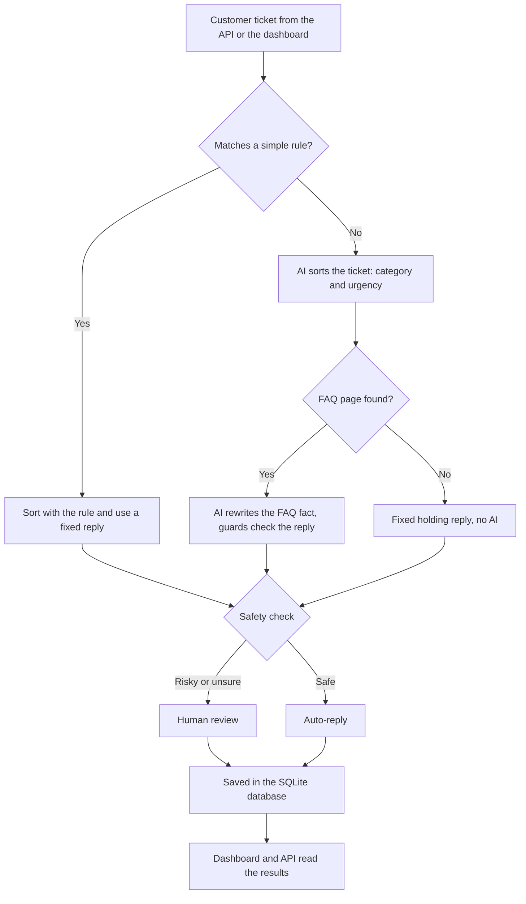

# AI Support Ticket Helper


An AI system that sorts customer support tickets, drafts replies from a company FAQ, and sends risky tickets to a human. It has a REST API, a database, and a dashboard. It runs fully on a laptop with free local models, so it costs nothing to run.


## Why I built it

Support teams spend a lot of time reading and sorting the same kinds of messages. I wanted to build a small version of a real AI system where the model is only one part of the design, and where plain code decides what is safe to send.

## What it does

1. **Rules first.** Easy tickets (unsubscribe, opening hours, password reset, returns) are handled by plain code. No AI is used, and they get a fixed reply.
2. **AI sorts the rest.** A local language model picks a category and an urgency. Pydantic forces the answer into a fixed shape.
3. **FAQ search.** The ticket is turned into an embedding and matched against a small company FAQ.
4. **Grounded reply.** If an FAQ page matches, the model may only rewrite that fact. If nothing matches, no AI is used and the customer gets a fixed "a team member will follow up" reply.
5. **Reply guards.** If the model adds a new number or much more text than the fact, its reply is thrown away and the plain fact is used instead.
6. **A safety check decides.** Risky tickets go to a human instead of being sent automatically.
7. **Everything is saved.** The REST API stores every ticket in a SQLite database. A Streamlit dashboard shows results, the FAQ, and a live box to try a new ticket.

## Workflow



## REST API

Start it with `uv run uvicorn api:app --reload`. FastAPI builds an interactive test page at `http://127.0.0.1:8000/docs`.

| Endpoint | What it does |
|---|---|
| `POST /tickets` | Send a customer message. It runs the whole pipeline, saves the result, and returns it. |
| `GET /tickets` | List the newest saved tickets. |
| `GET /tickets/{id}` | Get one saved ticket. |
| `GET /stats` | Count total tickets, tickets sent to a human, and tickets sorted by rules. |
| `GET /health` | Check that the service is running. |

## Safety check

A ticket is sent to a human if any of these is true. This check is plain code, not AI, so it behaves the same every time.

| Check | Why |
|---|---|
| Urgency is high | The customer is blocked or losing money right now. |
| Category is billing or refund | Money decisions need a person. |
| The reply contains a number or time | The model can invent facts, such as made-up opening hours. |
| The reply contains a risky word (for example "guarantee" or "promise") | The model should never promise things on behalf of the company. |

## Keeping replies grounded

An early test showed the model inventing details even when told not to (a made-up unsubscribe link, made-up opening hours, and "yes, we sell gift cards" with no such fact). Instructions alone were not enough, so the controls moved into code:

- The model only writes when it has a fact from the FAQ. Without a fact, a fixed reply is used.
- A reply with a number that is not in the fact is replaced by the plain fact.
- A reply much longer than the fact is replaced by the plain fact.

Every reply also records its source (a fixed rule reply, a named FAQ page, or a holding reply), so a reviewer can see why the system said what it said.

## Tech stack

| Part | Tool |
|---|---|
| Language | Python 3.12 |
| Chat model | llama3.2, run locally with Ollama |
| Embeddings (FAQ search) | nomic-embed-text, run locally with Ollama |
| Model access | OpenAI-compatible Python SDK (model and server are set in `.env`) |
| Structured output | Pydantic |
| API | FastAPI and Uvicorn |
| Database | SQLite |
| Dashboard | Streamlit |
| Tests | pytest |
| Packages and environment | uv |
| Version control | Git and GitHub |

## Results

Measured against hand-labeled data. The tickets and messages are fake.

**Sorting (30 tickets, answer key labeled by me)**

| Test | Category | Urgency |
|---|---|---|
| First version (tickets 1-10) | 9 of 10 | 7 of 10 |
| After prompt and rule changes (tickets 1-10) | 10 of 10 | 10 of 10 |
| Fresh tickets never used for tuning (tickets 11-30) | 19 of 20 | 18 of 20 |

All 3 mistakes on the fresh tickets were still sent to a human by the safety check.

**FAQ replies (10 messages I wrote: 7 with an FAQ answer, 3 without)**

| Test | Result |
|---|---|
| Right FAQ page chosen (or correctly none) | 9 of 10 |
| Replies with no invented facts, before the guards | about 8 of 10 |
| Replies with no invented facts, after the guards | 10 of 10 |

The one wrong FAQ choice was a safe miss: the ticket got the "a team member will follow up" reply. I changed the guards after seeing these same 10 messages, so the last score is not a fresh test.

## Tests

The pytest tests cover the rules, the safety check, the database, and the API. The database and API tests use a temporary database and a fake pipeline, so they run in a second and need no model.

```
uv run pytest
```

## Project structure

```
ticket_helper/
├── src/
│   ├── classifier.py   AI sorter: category and urgency
│   ├── rules.py        simple rules that run before the AI
│   ├── knowledge.py    FAQ search with embeddings
│   ├── replier.py      grounded reply writer, fixed replies, reply guards
│   ├── safety.py       decides auto-reply or human review
│   ├── pipeline.py     one function that runs the whole system for a message
│   └── database.py     SQLite storage for tickets
├── data/
│   ├── tickets.json    30 fake tickets
│   ├── answer_key.json the correct category and urgency for each ticket
│   └── faq.json        the company FAQ (made-up facts for the demo)
├── tests/              automatic tests for the rules, safety check, database, and API
├── docs/               dashboard screenshot
├── api.py              FastAPI service
├── main.py             runs the pipeline over the sample tickets
├── dashboard.py        Streamlit dashboard
├── evaluate.py         scores the sorter against the answer key
├── evaluate_replies.py checks FAQ choice and reply grounding
└── pyproject.toml      packages
```

## How to run it

1. Install [Ollama](https://ollama.com), then download the two models:

   ```
   ollama pull llama3.2
   ollama pull nomic-embed-text
   ```

2. Install the packages:

   ```
   uv sync
   ```

3. Create a file named `.env` in the main folder with these three lines:

   ```
   LLM_BASE_URL=http://localhost:11434/v1
   LLM_API_KEY=ollama
   LLM_MODEL=llama3.2
   ```

4. Start the model server in one terminal and leave it running:

   ```
   ollama serve
   ```

5. In a second terminal, run any of these:

   ```
   uv run uvicorn api:app --reload      # start the REST API
   uv run main.py                       # process the sample tickets
   uv run streamlit run dashboard.py    # open the dashboard
   uv run evaluate.py                   # score the sorter against the answer key
   uv run evaluate_replies.py           # check the FAQ replies
   uv run pytest                        # run the tests
   ```

Run `uv run main.py` once before opening the dashboard, so it has results to show.

If Ollama crashes with a CUDA error on a computer with an old graphics driver, run it on the CPU instead. In PowerShell:

```
$env:CUDA_VISIBLE_DEVICES="-1"
ollama serve
```

## Design decisions

- **Use as little AI as possible.** Plain rules run first because they are free, instant, and always the same.
- **Plain code decides what is risky.** The model can be wrong, so a deterministic safety check has the final say.
- **Controls live in code, not in the prompt.** The model ignored "do not invent facts" in testing, so the limits are enforced by code.
- **One function runs the system.** `process_ticket` hides all the steps, so the API, the dashboard, and the scripts share the same logic.
- **Measure before changing.** Prompt changes were tested against an answer key, and fresh tickets were added so the score is not just memorized.
- **The models are configurable.** The model and server are set in `.env`, so a hosted model can be used without code changes.

## Limits and next steps

- The tickets, FAQ, and test messages are fake, and I labeled them myself. The test sets are small.
- A small local model makes mistakes, mainly on urgency.
- The reply guards are strict, so the model's own wording is often replaced by the plain fact. The replies are safe but plain.
- FAQ search misses some phrasings (for example "When can I reach your support team?").
- The dashboard still reads `output/results.json`. Connecting it to the database is a next step.
- Next: tests that run automatically on GitHub (CI), Docker, a comparison with a larger model, and a deployed demo.
